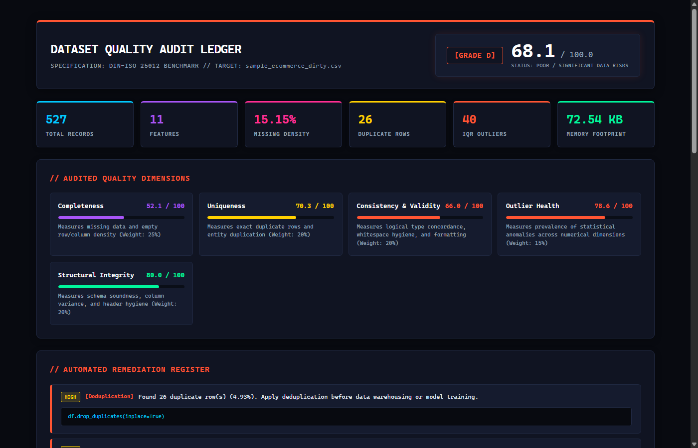
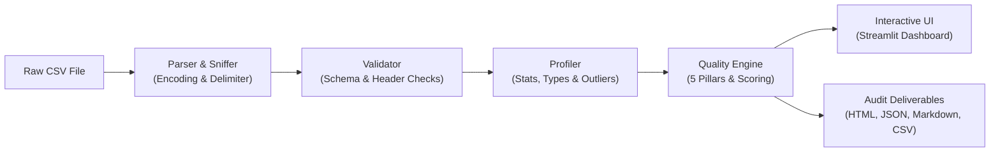

# 🛡️ Automated Dataset Quality & Profiling Engine

[](https://github.com/raguramrrp)
[](https://www.python.org/)
[](https://streamlit.io/)
[](https://pandas.pydata.org/)
[](https://pytest.org/)
[](LICENSE)

> **Day 2 of 90 Days – 90 Projects Challenge**  
> **Domain:** Data Engineering / Analytics / Data Governance    
> **Estimated Build Time:** 4 Hours  

---

## 📌 Problem Statement

Data engineers, analytics teams, and data scientists spend up to **80% of their project time** manually inspecting and cleaning raw datasets. Manual checks for missing values, silent duplicates, type mismatches, and extreme statistical anomalies are slow, error-prone, and delay analytical deliverables.

## 💡 The Solution

An end-to-end, high-performance **Automated Dataset Quality & Profiling Engine**. Simply upload any CSV dataset to immediately receive:
1. **Multi-Encoding & Delimiter Sniffing:** Automatic detection for UTF-8, Latin-1, CP1252, commas, semicolons, tabs, and pipes.
2. **Deep Exploratory Profiling:** Semantic type inference, missing value patterns, duplicate rows, and cardinality analysis.
3. **Dual Statistical Outlier Detection:** Tukey's Interquartile Range (IQR) bounds and standardized Z-score analysis.
4. **Transparent 0–100 Quality Scoring:** Explainable composite score across 5 quality pillars with letter grades (A through F).
5. **Actionable Python Code Directives:** Automated recommendations with copy-pasteable remediation code snippets.
6. **Multi-Format Audit Deliverables:** Downloadable standalone HTML reports, CI/CD-ready JSON schemas, Markdown summaries, and one-click auto-cleaned CSVs.

---

## 📸 Visual Tour & Application Showcase

### Standalone Interactive HTML Quality Report


### Live Streamlit Dashboard Shell


---

## 🏗️ System Workflow & Architecture



---

## 🎯 5 Pillars of Data Quality

The engine computes an explainable, deterministic 0–100 Data Quality Score based on 5 fundamental dimensions:

$$\text{Composite Score} = 0.25 \cdot S_{\text{comp}} + 0.20 \cdot S_{\text{uniq}} + 0.20 \cdot S_{\text{val}} + 0.15 \cdot S_{\text{outl}} + 0.20 \cdot S_{\text{struct}}$$

| Pillar | Weight | Focus Areas | Penalization Criteria |
| :--- | :---: | :--- | :--- |
| **Completeness** | **25%** | Missing data density | Overall missing cell %, all-null rows, and 100% empty columns. |
| **Uniqueness** | **20%** | Entity redundancy | Exact duplicate rows, candidate primary key collisions. |
| **Validity & Consistency** | **20%** | Semantic hygiene | Untrimmed whitespace, numbers stored as strings, invalid negative values. |
| **Outlier Health** | **15%** | Statistical anomalies | Tukey IQR outlier frequency, severe Z-score anomalies ($|z| > 3.0$). |
| **Structural Integrity** | **20%** | Schema soundness | Zero-variance constant columns, unnamed index columns, duplicate headers. |

### Letter Grade Rubric
- **Grade A (90.0 – 100.0):** Production Ready / Pristine condition.
- **Grade B (80.0 – 89.9):** Good Quality / Minor cleaning recommended.
- **Grade C (70.0 – 79.9):** Fair Quality / Moderate data curation required.
- **Grade D (60.0 – 69.9):** Poor Quality / Significant data hygiene risks.
- **Grade F (< 60.0):** Critical Defects / Unusable without substantial remediation.

---

## 🖥️ Application UI Screens

The application is structured into 4 cohesive screens:

1. **📥 Upload & Ingestion Screen:**
   - Drag-and-drop CSV uploader with 200MB capacity.
   - Quick selector for pre-packaged benchmark datasets (*Dirty E-Commerce*, *Employee Records*, *Clean Baseline*).
   - Ingestion telemetry (detected delimiter, encoding, raw row counts, parse execution duration).
   - Raw data preview table with adjustable sampling limits.

2. **📊 Dataset Overview Screen:**
   - Executive Quality Score Hero Card with letter grade.
   - 5 Pillars of Quality Radar Chart.
   - Core KPIs (Total Rows, Columns, Missing %, Duplicate %, Total Outliers, Memory Footprint).
   - Missing Values by Column bar chart.
   - Prioritized Automated Remediation directives with copy-pasteable Python code snippets.

3. **🔍 Column Deep-Dive Screen:**
   - Dedicated column inspector with individual health grades and logical inferred types.
   - Numerical Columns: Interactive distribution histogram, Tukey outlier boxplot with lower/upper fences, and parametric statistics (mean, std, median, IQR, skewness, kurtosis, zero/negative counts).
   - Categorical Columns: Frequency breakdown bar chart, mode frequency, string length metrics, and untrimmed whitespace counts.
   - Datetime Columns: Earliest date, latest date, and temporal span in days.

4. **📑 Quality Report & Export Center:**
   - Comprehensive Column Quality Matrix.
   - **One-Click Exportable Artifacts:**
     - 🌐 **HTML Report:** Responsive, self-contained standalone audit report.
     - 📄 **JSON Audit:** Structured schema for automated CI/CD pipeline validation.
     - 📝 **Markdown Summary:** Ready for GitHub PR descriptions or Jira tickets.
     - 📊 **Column CSV:** Tabular statistical summary.
     - 🧹 **Auto-Cleaned CSV:** Cleaned dataset with whitespace trimmed and duplicates purged.

---

## 📁 Repository Structure

```
90-days-90-projects-day-02-csv-data-quality-inspector/
├── .gitignore                     # Git ignore rules (.venv, caches, exports)
├── .env.example                   # Environment configuration template
├── LICENSE                        # MIT License
├── pyproject.toml                 # Build system & pytest configuration
├── requirements.txt               # Pinned project dependencies
├── setup.bat                      # 1-click Windows automated installer
├── run.bat                        # 1-click Windows application launcher
├── test.bat                       # 1-click Windows automated test runner
├── QUICKSTART.md                  # 2-minute quick start guide
├── DEMO_SCRIPT.md                 # 3-5 minute live demonstration script
├── README.md                      # Comprehensive project documentation
├── data/                          # Benchmark datasets
│   ├── README.md                  # Dataset descriptions & ground truth
│   ├── sample_ecommerce_dirty.csv # Flawed e-commerce order dataset
│   ├── sample_employee_records.csv# Messy HR records with constant column
│   └── sample_clean_baseline.csv  # Pristine baseline dataset
├── docs/                          # In-depth architectural documentation
│   ├── ARCHITECTURE.md            # Detailed system design & Mermaid diagrams
│   ├── PROJECT_OVERVIEW.md        # Problem statement & business value
│   ├── USER_GUIDE.md              # Screen-by-screen user guide
│   ├── DEVELOPMENT_NOTES.md       # Technical challenges & Pandas 3.0 migration
│   ├── TESTING.md                 # Test suite matrix & verification
│   └── TROUBLESHOOTING.md         # Common issues, FAQ & remedies
├── screenshots/                   # Visual demonstration assets
│   ├── README.md                  # Screenshots walkthrough guide
│   ├── 01_html_quality_report.png # High-res capture of HTML audit report
│   └── 02_streamlit_overview.png  # Streamlit dashboard interface capture
├── scripts/                       # Automation scripts
│   ├── generate_sample_data.py    # Synthetic benchmark dataset generator
│   └── capture_screenshots.py     # Headless Chrome screenshot capture
├── src/                           # Application source code
│   ├── __init__.py                # Package exports
│   ├── parser.py                  # CSV ingestion, encoding & delimiter sniffing
│   ├── validator.py               # Schema sanity & structural checks
│   ├── profiler.py                # EDA, type inference, stats, outlier detection
│   ├── quality_engine.py          # 5-dimension scoring & recommendation engine
│   ├── report_generator.py        # HTML, JSON, and Markdown report rendering
│   └── app.py                     # Streamlit web application
└── tests/                         # Automated test suite (25 tests)
    ├── test_parser.py             # Ingestion & parser unit tests
    ├── test_validator.py          # Structural validation unit tests
    ├── test_profiler.py           # Statistical profiling unit tests
    ├── test_quality_engine.py     # Quality scoring & grading unit tests
    ├── test_report_generator.py   # Multi-format report generator tests
    └── test_e2e.py                # End-to-end integration tests on sample data
```

---

## ⚡ Quick Start & Setup

### Option 1: Automated 1-Click Setup (Windows)
```cmd
setup.bat
```
This script detects Python 3.10–3.12, creates `.venv`, installs dependencies from `requirements.txt`, and generates all benchmark datasets.

### Option 2: Manual Setup
```cmd
# 1. Create virtual environment
python -m venv .venv

# 2. Activate virtual environment
# Windows:
.\.venv\Scripts\activate
# macOS/Linux:
source .venv/bin/activate

# 3. Install dependencies
pip install -r requirements.txt

# 4. Generate benchmark datasets
python scripts/generate_sample_data.py

# 5. Launch web application
streamlit run src/app.py
```

---

## 🧪 Automated Testing & Verification

The project includes 25 unit and end-to-end integration tests executed via `pytest`:

```cmd
test.bat
```

```
============================= test session starts =============================
platform win32 -- Python 3.12.6, pytest-9.1.1, pluggy-1.7.0
rootdir: 90-days-90-projects-day-02-csv-data-quality-inspector
configfile: pyproject.toml
collected 25 items

tests/test_e2e.py::test_e2e_clean_baseline PASSED                        [  4%]
tests/test_e2e.py::test_e2e_dirty_ecommerce PASSED                       [  8%]
tests/test_e2e.py::test_e2e_employee_records PASSED                      [ 12%]
tests/test_parser.py::test_detect_encoding PASSED                        [ 16%]
tests/test_parser.py::test_detect_delimiter PASSED                       [ 20%]
tests/test_parser.py::test_parse_csv_string_content PASSED               [ 24%]
tests/test_parser.py::test_parse_csv_bytes_io PASSED                     [ 28%]
tests/test_parser.py::test_parse_csv_empty_content PASSED                [ 32%]
tests/test_parser.py::test_parse_csv_malformed_lines PASSED              [ 36%]
tests/test_profiler.py::test_infer_logical_type PASSED                   [ 40%]
tests/test_profiler.py::test_detect_outliers_iqr PASSED                  [ 44%]
tests/test_profiler.py::test_detect_outliers_zscore PASSED               [ 48%]
tests/test_profiler.py::test_profile_column_numeric PASSED               [ 52%]
tests/test_profiler.py::test_profile_dataset PASSED                      [ 56%]
tests/test_quality_engine.py::test_quality_score_pristine_data PASSED    [ 60%]
tests/test_quality_engine.py::test_quality_score_heavily_degraded_data PASSED [ 64%]
tests/test_quality_engine.py::test_column_health_grading PASSED          [ 68%]
tests/test_report_generator.py::test_generate_json_report PASSED         [ 72%]
tests/test_report_generator.py::test_generate_markdown_report PASSED     [ 76%]
tests/test_report_generator.py::test_generate_html_report PASSED         [ 80%]
tests/test_validator.py::test_validate_empty_dataset PASSED              [ 84%]
tests/test_validator.py::test_validate_clean_dataset PASSED              [ 88%]
tests/test_validator.py::test_validate_delimiter_failure PASSED          [ 92%]
tests/test_validator.py::test_validate_unnamed_and_duplicate_columns PASSED [ 96%]
tests/test_validator.py::test_validate_all_nan_rows_and_cols PASSED      [100%]

======================== 25 passed, 1 warning in 1.33s ========================
```

---

## 🚀 Upgrade Path & Roadmap

- [ ] **Automated Cleaning Pipelines:** Integration with Scikit-Learn iterative and KNN imputers.
- [ ] **Data Quality Gate CLI:** Headless CLI command for pre-commit Git hooks and Airflow DAG triggers.
- [ ] **Polars Backend:** High-speed streaming engine for massive 10GB+ CSV files.
- [ ] **ML Anomaly Detection:** Isolation Forest and Local Outlier Factor (LOF) for multivariate anomaly detection.

---

## 📄 License

This project is licensed under the terms of the [MIT License](LICENSE).

---

*Part of the **90 Days – 90 Projects Challenge** by [Raguram](https://github.com/raguramrrp).*
