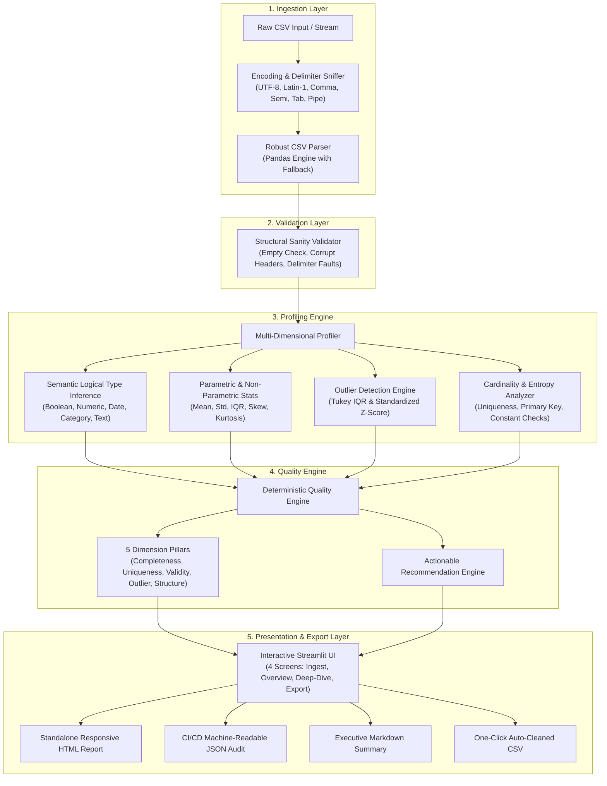

# System Architecture & Technical Specifications

**Automated Dataset Quality & Profiling Engine**  
*Day 2 — 90 Days 90 Projects Challenge*

---

## 1. High-Level System Architecture

The engine is built around a decoupled, modular pipeline adhering to single-responsibility engineering principles. Every processing phase transforms data deterministically without side effects.

---

## 2. Core Modules & Component Architecture

### `src/parser.py` (Ingestion & Sniffing)
- **Role:** Safely loads tabular data from files, byte streams, or strings into memory.
- **Key Functions:**
  - `detect_encoding(bytes)`: Tests UTF-8, UTF-8-SIG, Latin-1, CP1252, ISO-8859-1 with graceful fallback.
  - `detect_delimiter(str)`: Hybrid sniffer utilizing `csv.Sniffer` combined with a line-by-line consistency heuristic across common delimiters (`,`, `;`, `\t`, `|`, `:`).
  - `parse_csv(...)`: Executes parsing with telemetry timing, memory tracking, and error-resilient fallback to the Python parsing engine if C-parser encounters tokenization conflicts.

### `src/validator.py` (Structural Integrity)
- **Role:** Sanity-checks the DataFrame before compute-heavy statistical routines are dispatched.
- **Key Checks:**
  - Empty dataset / zero-cell detection.
  - Delimiter failure diagnosis (flags single-column outputs that embed delimiter characters in row values).
  - Column header sanitation (unnamed index columns, duplicate names, whitespace in headers).
  - All-NaN rows and columns tracking.

### `src/profiler.py` (Exploratory Data Analysis)
- **Role:** Computes mathematical, distribution, and structural metrics across all features.
- **Key Capabilities:**
  - **Semantic Type Inference:** Distinguishes storage types from logical types (`Boolean`, `Integer`, `Float`, `Datetime`, `Categorical`, `Text`, `Text (Long)`).
  - **Tukey's IQR Outlier Detection:** Computes $Q_1$, $Q_3$, $\text{IQR} = Q_3 - Q_1$, and fences $[Q_1 - 1.5\cdot\text{IQR},\, Q_3 + 1.5\cdot\text{IQR}]$.
  - **Standardized Z-Score Outlier Detection:** Flags observations where $|z| = \left|\frac{x - \mu}{\sigma}\right| > 3.0$.
  - **Cardinality Analysis:** Distinct value count, uniqueness ratios, primary key candidacy, and zero-variance constant column identification.

### `src/quality_engine.py` (Composite Scoring & Grading)
- **Role:** Translates raw profiling statistics into an intuitive, explainable 0–100 score and letter grades.
- **Mathematical Scoring Formula:**

$$\text{Overall Score} = 0.25 \cdot S_{\text{comp}} + 0.20 \cdot S_{\text{uniq}} + 0.20 \cdot S_{\text{val}} + 0.15 \cdot S_{\text{outl}} + 0.20 \cdot S_{\text{struct}}$$

Where:
- $S_{\text{comp}} = \max\left(0,\, 100 - (\text{missing\_pct} \times 2.5) - (\text{empty\_rows} \times 5) - (\text{empty\_cols} \times 15)\right)$
- $S_{\text{uniq}} = 100$ if duplicates $= 0$ else $\max\left(0,\, 100 - 10 - (\text{duplicate\_pct} \times 4)\right)$
- $S_{\text{val}} = \max\left(0,\, 100 - (\text{type\_mismatches} \times 8) - (\text{whitespace\_cols} \times 8) - (\text{negative\_cols} \times 10)\right)$
- $S_{\text{outl}} = \max\left(0,\, 100 - (\text{avg\_outlier\_pct} \times 6) - (10 \text{ if negative anomalies exist})\right)$
- $S_{\text{struct}} = \max\left(0,\, 100 - (\text{constant\_cols} \times 15) - (\text{warnings} \times 5)\right)$

### `src/report_generator.py` (Audit Generation)
- **Role:** Generates self-contained, publication-ready reports in HTML, JSON, Markdown, and CSV formats.
- **Design:** CSS is embedded directly in HTML reports, ensuring they render flawlessly offline, in email clients, or when converted to PDF.

### `src/app.py` (Streamlit Web Dashboard)
- **Role:** Interactive dashboard with cached pipelines (`st.cache_data`) ensuring responsive UX during interactive drill-downs and exports.
